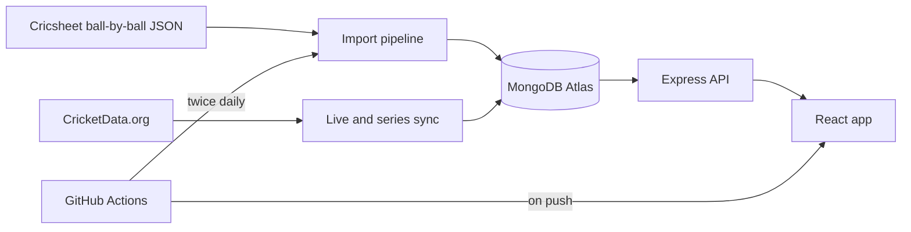

<div align="center">

# 🏏 Crease Club

### Cricket analytics for the IPL, WPL, India internationals and Indian domestic cricket

Playing XIs · year-wise player stats · Elo win predictor · live and upcoming fixtures

[](https://<you>.github.io/<repo>/)
[](https://github.com/<you>/<repo>/actions/workflows/deploy.yml)
[](https://github.com/<you>/<repo>/actions/workflows/data-refresh.yml)
[](LICENSE)


<!-- Add a 15-20 second screen recording here: docs/demo.gif -->


</div>

> The free-tier API sleeps when idle, so the **first load of the live demo can take up to a minute**. The GIF above shows the full flow.

## ✨ What it does
| | |
|---|---|
| 🏆 **IPL and WPL** | Franchise cards with trophy badges and a men's/women's filter |
| 🌏 **India internationals** | Test, ODI and T20I records for men and women, with per-format team pages |
| 🏟️ **Domestic cricket** | Pick a tournament (Ranji, Vijay Hazare, SMAT, women's trophies and more) to see its teams, champions and upcoming fixtures |
| 📡 **Live and upcoming** | Matches in play now and fixtures in the next 5 days, with one-click predictions |
| 👥 **Team pages** | Season filter, record, venue form, **squads built from real lineups**, and a match lookback with every player's runs, wickets and impact |
| 🧑 **Player cards** | Role-aware stats (batting, bowling or both), position tags and a **year-by-year** dropdown |
| 🔮 **Crystal Ball** | Win probability from Elo rating, recent form, toss and venue |

## 🧱 Architecture

| Layer | Tech | Hosted on |
|---|---|---|
| Frontend | React, Vite, Tailwind CSS, SCSS | GitHub Pages |
| API and sync jobs | Node.js, Express, Mongoose | Render (any Node host works) |
| Database | MongoDB | Atlas free tier |
| CI/CD | GitHub Actions | Deploys on push; refreshes data twice a day |

## 🛠️ Engineering highlights
- **Data pipeline:** parses thousands of ball-by-ball match files into lineups, per-match impact scores and year-wise player stats. It classifies each match (IPL, WPL, India international, domestic) and rebuilds teams, players and champions in one idempotent run.
- **Two sources, no duplicates:** every match gets a stable key (`league | format | date | teams`) with a unique index, so the dataset and the live API can both write the same match without double-counting.
- **Source trust rules:** finished internationals come only from the dataset, because the live feed produced unverifiable rows. Live data drives live and upcoming fixtures only.
- **Quota-aware polling:** the sync reads the API's hit counter and backs off before the daily limit, and it polls faster only while a match is live.
- **Transparent predictor:** Elo (K = 24) plus form, toss and venue adjustments. It is a heuristic, not a trained ML model, and it is documented as such.
- **Per-tournament champions:** honours are derived from finals found in the data, with a small JSON override for tournaments the dataset doesn't cover.

## 📊 By the numbers
`[N]` matches · `[N]` players · `[N]` tournaments · data refreshed twice daily

## 🚀 Run locally
Requires Node 18+ and a MongoDB database (local or Atlas).
```bash
git clone https://github.com/<you>/<repo>.git && cd <repo>

# API
cd server && cp .env.example .env     # set MONGO_URI (and CRICKETDATA_KEY if you have one)
npm install
npm run update:data                   # download Cricsheet data and import it (Windows/PowerShell)
npm run dev                           # http://localhost:5000

# Web (new terminal)
cd client && npm install && npm run dev   # http://localhost:5173
```
On macOS or Linux, download the Cricsheet zips into `data/` yourself and run `npm run import:all`.

<details>
<summary><b>Environment variables</b></summary>

| Variable | Where | Purpose |
|---|---|---|
| `MONGO_URI` | server | MongoDB connection string |
| `CRICKETDATA_KEY` | server | CricketData.org key for live and upcoming fixtures (optional) |
| `ELITESPORT_BASE_URL`, `ELITESPORT_KEY` | server | Optional second feed. It's a scaffold and needs its response mapped before use |
| `VITE_API_URL` | client build | Public URL of the API (set from the repo variable `API_URL`) |
| `VITE_BASE` | client build | Base path for GitHub Pages (set automatically in CI) |
</details>

<details>
<summary><b>Useful commands (in <code>server/</code>)</b></summary>

| Command | Purpose |
|---|---|
| `npm run import:all` | Rebuild matches, players, teams and honours from `data/` |
| `npm run update:data` | Download fresh Cricsheet zips, then import |
| `npm run audit` | Counts and duplicate check |
| `npm run finals` | Show the finals found for a tournament |
| `npm run probe` | Check which tournaments the live API carries |
| `npm run reset:live` | Remove API-sourced matches so they refill cleanly |
</details>

## ☁️ Deploy
1. **Database:** create a free MongoDB Atlas cluster and allow network access from your host and from GitHub Actions.
2. **API:** create a Web Service on Render. Root `server`, build `npm install`, start `npm start`. Add `MONGO_URI` and optionally `CRICKETDATA_KEY`.
3. **Site:** in the repo, set Settings → Pages → Source to **GitHub Actions**. Add the variable `API_URL` (your API's URL, no trailing slash) and the secret `MONGO_URI`.
4. Push to `main`. **Deploy site** publishes the app, and **Refresh data** re-imports Cricsheet data twice a day (you can also run it by hand from the Actions tab).

## 🗺️ Roadmap
- [ ] Batter-vs-bowler matchups from ball-by-ball data
- [ ] A trained win-probability model, back-tested against past matches
- [ ] Lineups and player stats for the domestic tournaments Cricsheet doesn't publish
- [ ] Auth and a saved-players page
- [ ] Static snapshot mode for fully serverless hosting

## ⚠️ Known limitations
- Jersey numbers are generated, because the data has none.
- Ranji Trophy, Vijay Hazare and similar tournaments have fixtures and results only when the live API carries them, and they have no lineups.
- Year-wise figures are built from match totals, so Test innings are combined per match.
- New results can lag by up to a day, until the next data refresh.

## 🙏 Credits
Ball-by-ball data from [Cricsheet](https://cricsheet.org). Live fixtures from [CricketData.org](https://cricketdata.org). Please check each provider's licence before reusing their data.

## 📄 License
MIT. Not affiliated with the BCCI, IPL, WPL or ICC.

<div align="center">

Built by **Niveditha Sury** · [LinkedIn](https://www.linkedin.com/in/<your-profile>) · [GitHub](https://github.com/<you>)

</div>